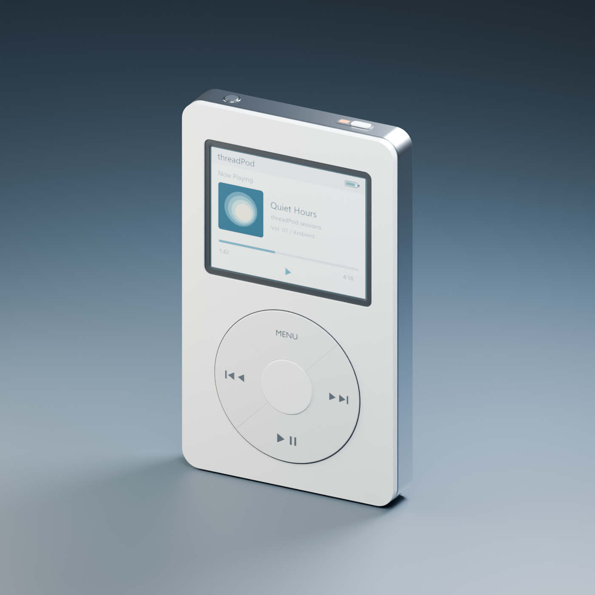

# threadPod 3D asset

Created from scratch in Blender 5.2.3 LTS; this workspace contained no previous threadPod model. Existing portfolio files were not modified.

This bundle is stored in `model/astra/`. The existing `model/threadpod.blend` and `public/models/threadpod.glb` remain the app's original assets. Integrating this variant requires adapting the app's node names and scale; this upload does not switch the running app to the new model.



## Deliverables

- `output/threadPod.blend`: editable meshes, named materials, packed screen texture, lights, camera and inspection animation.
- `output/threadPod.glb`: self-contained browser asset, without the studio or lights.
- `output/threadPod_preview.png` and `output/threadPod_front.png`: Cycles renders.
- `output/validation.json`: Blender geometry and round-trip import checks.
- `output/glb_checks.json`: binary glTF accessor, normal, texture and dependency checks.
- `scripts/build_threadpod.py`, `scripts/make_screen.py`, `scripts/inspect_glb.py`: reproducible source.

The nominal casing is 62 × 103 × 11 mm; controls and sockets protrude slightly. Exported units are meters, +Y is up, and +Z faces the viewer. The root origin is at the device center. The single 512 × 384 display texture is embedded, as are PBR materials. No Draco or external decoder is required. Clearcoat uses `KHR_materials_clearcoat`.

## Interaction hierarchy

| Node | Purpose |
| --- | --- |
| `threadPod` | Whole-device rotation / inspection |
| `ClickWheel` | Wheel group, rotates around local Z in glTF |
| `Button_Menu` | Menu sector with child label |
| `Button_Next` | Forward sector with child symbols |
| `Button_Previous` | Backward sector with child symbols |
| `Button_PlayPause` | Playback sector with child symbols |
| `Button_Select` | Center button |
| `Switch_Hold` | Top hold switch |
| `Screen_Display` | Display plane; replace its material map for a live screen |

Each button pivot is centered on the control. For a press, move its local Z inward by approximately 0.00015 meters, then restore its original position. Labels follow their parent buttons. Handle raycast hits by walking upward to an object with `userData.interactive`; printed labels can be the first hit. Click-wheel drag coordinates can be measured in the wheel's local XY plane with `worldToLocal` and `atan2`. The wheel is normally stationary on a classic device; rotate it only if that suits the application.

## Three.js

Copy `output/threadPod.glb` to your app's public assets directory. Load it with `GLTFLoader`:

```js
import { GLTFLoader } from 'three/addons/loaders/GLTFLoader.js';
import { AnimationMixer } from 'three';

const gltf = await new GLTFLoader().loadAsync('/assets/threadPod.glb');
scene.add(gltf.scene);
const select = gltf.scene.getObjectByName('Button_Select');
const restZ = select.position.z;
// On press: select.position.z = restZ - 0.00015;
// On release/cancel: select.position.z = restZ;

const mixer = new AnimationMixer(gltf.scene);
const clip = gltf.animations.find(a => a.name === 'Inspection_360');
if (clip) mixer.clipAction(clip).play(); // Optional; stop for direct drag inspection.
// Call mixer.update(deltaSeconds) in your existing animation loop.
```

Start with a perspective camera at `[0.11, 0.07, 0.20]`, near plane `0.001`, far plane `10`, looking at the origin. Supply an environment map for the metal, moderate lighting, and tone mapping. The Blender studio is intentionally excluded from the GLB.

## React Three Fiber

```jsx
import { Suspense, useMemo } from 'react';
import { Canvas, useLoader } from '@react-three/fiber';
import { GLTFLoader } from 'three/addons/loaders/GLTFLoader.js';

function Device({ onControl }) {
  const gltf = useLoader(GLTFLoader, '/assets/threadPod.glb');
  const model = useMemo(() => gltf.scene.clone(true), [gltf]);
  return <primitive object={model} onPointerDown={e => {
    let control = e.object;
    while (control && !control.userData.interactive) control = control.parent;
    if (control) {
      e.stopPropagation();
      onControl?.(control.name);
    }
  }} />;
}

export function Viewer({ onControl }) {
  return <Canvas camera={{ position: [0, 0, 0.20], near: 0.001, far: 10, fov: 40 }}>
    <ambientLight intensity={0.5} />
    <directionalLight position={[1, 2, 3]} intensity={2} />
    <Suspense fallback={null}><Device onControl={onControl} /></Suspense>
  </Canvas>;
}
```

Add your application's environment map to this minimal R3F example for polished metal reflections. Use a parent container with an explicit height. When replacing the display map, set the new texture's `flipY=false` and sRGB color space, and clone the material if multiple device instances need independent screens.

Loader references: [Three.js documentation](https://threejs.org/docs/) and [R3F model loading](https://r3f.docs.pmnd.rs/tutorials/loading-models).

## Rebuild

From the workspace in PowerShell:

```powershell
python model/astra/scripts/make_screen.py
& 'C:\Program Files\Blender Foundation\Blender 5.2\blender.exe' --background --factory-startup --python model/astra/scripts/build_threadpod.py
python model/astra/scripts/inspect_glb.py
```

The texture generator requires Pillow and uses Windows Segoe UI. The Blender script uses only bundled Python modules and `bpy`. Existing output files are copied into timestamped `backups/` folders before regeneration; previous screen textures are renamed alongside the texture. The `.blend` opens at the start of the inspection clip with the hero camera active.

## Validation and practical limits

The Blender export was re-imported into an emptied scene. All named interaction nodes and the animation survived. UVs, degenerate faces, finite attributes, unit-length normals, index bounds, embedded images, and material assignments were checked. Solid model meshes are closed; the display and printed graphics intentionally have open boundaries. Two rendered angles were visually reviewed for shading and placement.

The display uses a clearcoated opaque surface for predictable browser rendering, rather than a transmissive glass volume. Sockets are shallow visual details without internal electronics. The inspection clip is an eight-second seamless constant-speed turntable. Screen graphics are static until connected to application state.

The asset has been tested in Blender, not in a running Three.js/R3F app; integration snippets are starting points. No existing threadPod web implementation was present here. Blender emitted a nonfatal OS thumbnail-cache warning while saving; the actual `.blend`, GLB and renders succeeded.
